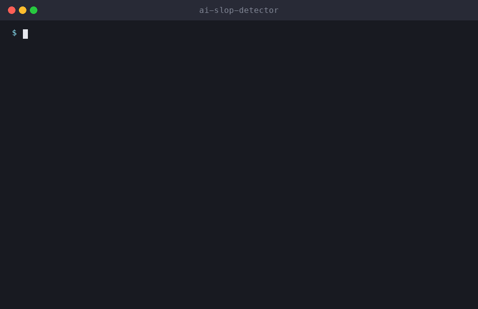

<div align="center">

# 🧹 ai-slop-detector

**Score text for AI-sounding writing and rewrite it to sound human, keeping the author's voice. An Agent Skill for Claude Code, Cline, Cursor, Codex and other AI coding agents.**

[](LICENSE)
[](https://github.com/milad-ahmd/ai-slop-detector)


[Install](#-install) · [Usage](#-usage) · [How it works](skills/ai-slop-detector/SKILL.md) · [All skills](https://github.com/milad-ahmd/agent-skills)



</div>

> Part of **[agent-skills](https://github.com/milad-ahmd/agent-skills)**, a growing collection of practical skills for AI coding agents.

## 📦 Install

**One command (installs the whole collection):**

```bash
curl -fsSL https://raw.githubusercontent.com/milad-ahmd/agent-skills/main/install.sh | bash -s -- ai-slop-detector
```

**Manually (Claude Code):**

```bash
git clone https://github.com/milad-ahmd/ai-slop-detector /tmp/ai-slop-detector
mkdir -p ~/.claude/skills && cp -r /tmp/ai-slop-detector/skills/ai-slop-detector ~/.claude/skills/
```

**Per project:** copy `skills/ai-slop-detector` into `<project>/.claude/skills/`.
**Any other agent:** paste [`SKILL.md`](skills/ai-slop-detector/SKILL.md) into your rules or system prompt.

## 💬 Usage

Just ask your agent:

```text
De-slop this blog post
Does this sound like AI? Make it sound human
```

The full workflow, rules and output format are in [`SKILL.md`](skills/ai-slop-detector/SKILL.md).

## 🧩 More skills

See the full collection: **[milad-ahmd/agent-skills](https://github.com/milad-ahmd/agent-skills)**.

## 🤝 Contributing

Issues and PRs are welcome, especially real-world before/after examples.

## 📄 License

[MIT](LICENSE) © Milad Ahmadi

<div align="center">

**If this skill saved you time, a ⭐ helps others find it.**

</div>
